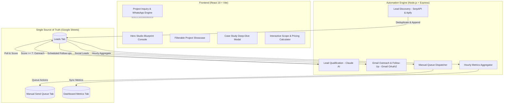

# Neural Flow — Anubhav Sharma Portfolio & Automation Cockpit ⚡

[](https://github.com/Anubhav-sharma-07/Anubhav_portfolio_neural-flow)
[](https://github.com/Anubhav-sharma-07/Anubhav_portfolio_neural-flow)
[](LICENSE)

> **"Digital experiences, built to move businesses forward."**  
> Flagship creative developer portfolio for **Anubhav Sharma** and digital agency platform for **Neural Flow**, featuring high-performance frontend engineering, verified client projects, interactive studio blueprints, and an autonomous B2B lead generation engine.

---

## 🌟 Highlights & Features

### 🖥️ Frontend: Creative Developer Experience
- **Interactive Studio Blueprint Console**: Real-time interactive telemetry console replacing heavy WebGL with instant ~300 kB bundle loading, live Core Web Vitals telemetry (99+ Lighthouse score), and capability switchers across Web Dev, Full-Stack, AI Solutions, and Automation.
- **Verified Real Projects**:
  1. **Minimalist E-Commerce Storefront** — High-converting modern shopping experience with cart state, instant filtering, and clean responsive layout.
  2. **Task & Workflow Management Suite** — Kanban-style productivity platform with drag-and-drop mechanics and local persistence.
  3. **Personal Brand & Agency Launchpad** — Editorial design system with micro-interactions, conversion triggers, and sleek typography.
  4. **Neural Flow Creative Portfolio** — Production developer portfolio built with Warm Ivory (`#F5F0E8`), Deep Charcoal (`#20201E`), and Burnt Orange (`#C65D35`).
  5. **Academic Research in Deep Learning & Healthcare** — Published co-authored research in the *International Journal of Computer Trends and Technology (IJCTT)* on early lung cancer detection via CNNs.
- **Dynamic Case Study Modal**: Deep architectural breakdowns, impact metrics, and live demo/repo links for every project.
- **Transparent 5-Stage Delivery Pipeline**: Discovery → Architecture & Prototyping → Development & Testing → Deployment → Optimization.
- **Interactive Project Scope Calculator**: Instant budget and timeline estimations with one-click inquiry pre-filling.
- **Direct Client Inquiry Engine**: Glassmorphic consultation modal with direct mailto fallback and 1-click WhatsApp business redirect.

### ⚙️ Backend: Neural Flow Autonomous Cockpit
- **Lead Discovery Engine**: Automated discovery of local and international businesses using SerpAPI (Google Maps) and Apify social media scrapers.
- **AI Qualification Pipeline**: Intelligent prospect scoring and personalized pitch generation powered by Anthropic's Claude API.
- **Automated Email Outreach**: Multi-stage cold email campaigns and automated follow-ups via personal Gmail OAuth2.
- **CRM Sync & Manual Queue**: Real-time two-way synchronization with Google Sheets (`NeuralFlow_CRM`), managing Leads, Manual LinkedIn/Instagram Queues, and Dashboard Metrics.

---

## 🏗️ System Architecture



---

## 📁 Repository Structure

```
Anubhav_portfolio_neural-flow/
├── frontend/
│   ├── src/
│   │   ├── components/
│   │   │   ├── HeroStudioConsole.jsx   # Interactive Studio capability console
│   │   │   ├── CaseStudyModal.jsx      # Detailed project modal & metrics
│   │   │   ├── ContactModal.jsx        # Client inquiry consultation form
│   │   │   ├── PricingCalculator.jsx   # Interactive scope & budget estimator
│   │   │   ├── Navbar.jsx              # Responsive navigation & mobile menu
│   │   │   ├── Footer.jsx              # Brand footer & social channels
│   │   │   └── ...
│   │   ├── data/
│   │   │   └── siteContent.js          # Unified content & verified project data
│   │   ├── App.jsx                     # Master portfolio application
│   │   ├── index.css                   # Tailwind CSS v4 design tokens
│   │   └── main.jsx                    # Vite entry point
│   ├── package.json
│   └── vite.config.js
├── backend/
│   ├── src/
│   │   ├── services/                   # Lead discovery, qualification, outreach
│   │   ├── integrations/               # Google Sheets, Claude, Gmail, SerpAPI
│   │   ├── jobs/                       # Background cron schedulers
│   │   └── server.js                   # Express API endpoints
│   ├── .env.example
│   └── package.json
├── .gitignore                          # Protected env & build artifacts
└── README.md
```

---

## 🚀 Quickstart & Local Development

### 1. Clone the Repository
```bash
git clone https://github.com/Anubhav-sharma-07/Anubhav_portfolio_neural-flow.git
cd Anubhav_portfolio_neural-flow
```

### 2. Run the Portfolio (Frontend)
```bash
cd frontend
npm install
npm run dev
```
Open **`http://localhost:5173`** in your browser.

### 3. Run the Automation Cockpit (Backend - Optional)
```bash
cd backend
npm install
cp .env.example .env
# Edit .env with your Google Sheets, Anthropic Claude, and Gmail OAuth credentials
npm start
```
Backend API will start on **`http://localhost:5000`**.

---

## 🎨 Color Palette & Design Tokens

| Token | Hex | Role |
| :--- | :--- | :--- |
| **Warm Ivory** | `#F5F0E8` | Primary background, clean editorial feel |
| **Deep Charcoal** | `#20201E` | High-contrast typography and structural containers |
| **Burnt Orange** | `#C65D35` | Signature brand accent, active tabs, buttons |
| **Warm Muted** | `#E8E2D8` | Borders, subtle dividers, secondary surface |

---

## 📬 Contact & Inquiries

- **Lead Developer**: Anubhav Sharma
- **Brand / Studio**: Neural Flow
- **Email**: [neuralflow7@gmail.com](mailto:neuralflow7@gmail.com)
- **GitHub**: [@Anubhav-sharma-07](https://github.com/Anubhav-sharma-07)
- **LinkedIn**: [Anubhav Sharma](https://www.linkedin.com/in/anubhav-sharma-51347628a/)

---

*Built with passion by Anubhav Sharma & Neural Flow.*
